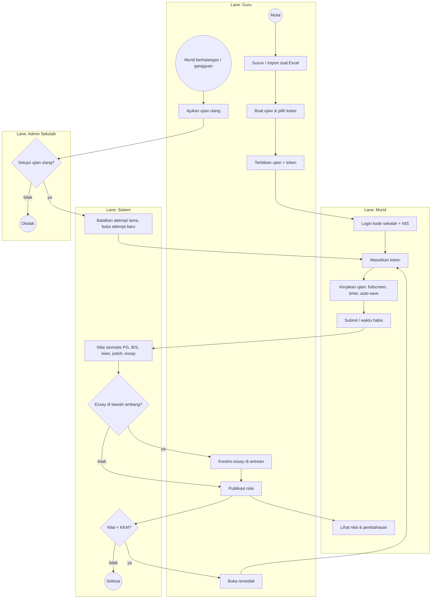
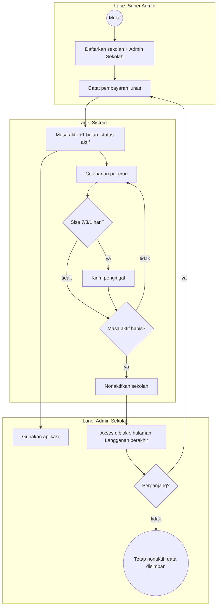
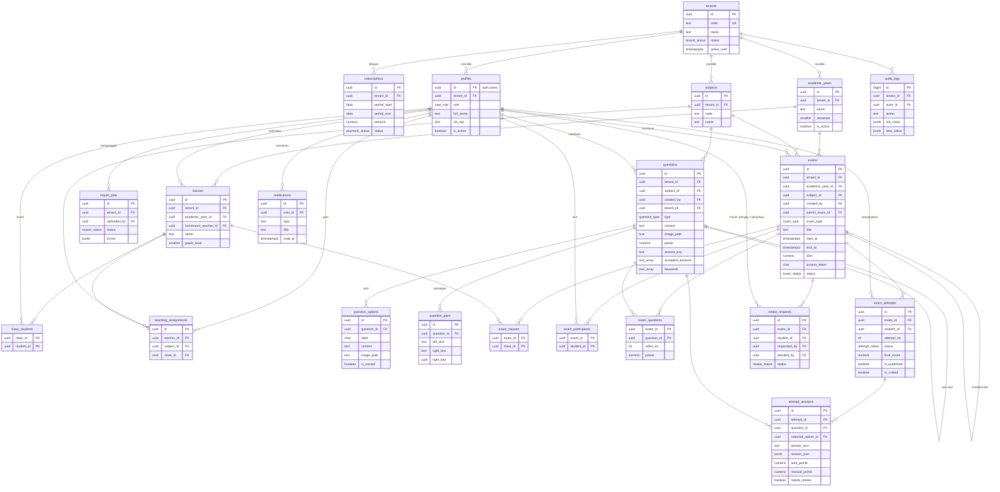

# PRD Website Ujian Sekolah

Oct 1, 2026 · @Nur Sayid Tamam

## Ringkasan Produk

Platform ujian online berbasis langganan (SaaS) untuk banyak sekolah: tiap sekolah berlangganan per bulan, guru membuat soal dan ujian, murid mengerjakan secara daring, nilai dihitung otomatis lalu dikoreksi dan dilaporkan.

**Masalah yang diselesaikan:** ujian kertas memakan waktu koreksi, rawan salah hitung, dan sulit direkap.

**Tujuan MVP:**

1. Satu platform melayani banyak sekolah (multi-tenant); data antar sekolah terisolasi penuh.
2. Akses sekolah aktif selama langganan berjalan dan otomatis nonaktif saat langganan 1 bulan berakhir.
3. Guru membuat soal manual atau import dari Excel, termasuk soal bergambar.
4. Murid login dengan kode sekolah + NIS, mengerjakan ujian dengan token, timer, dan auto-save.
5. Nilai dihitung otomatis, dikoreksi guru, dipublikasikan, dan bisa diekspor sebagai rapor.
6. Guru bisa membuka remedial; ujian ulang hanya dengan persetujuan Admin Sekolah.

**Struktur sekolah:** tahun ajaran, kelas, wali kelas, dan penugasan guru per mapel per kelas. Ujian ditargetkan ke kelas, dengan opsi menambah murid satu per satu.

**Tech stack:**

| Lapisan | Teknologi |
| --- | --- |
| Frontend | Next.js (Page Router) + TypeScript |
| UI | shadcn/ui + Tailwind CSS |
| Backend & DB | Supabase (PostgreSQL, Auth, Row Level Security, Storage untuk gambar) |
| Server logic | Next.js API Routes (`/pages/api`) + Postgres function (RPC) |
| Import Excel | SheetJS (`xlsx`) di API Route |
| Penjadwal | `pg_cron` (cek langganan harian) |
| Deploy | Vercel + Supabase Cloud |

## Peran & Hak Akses

Ada empat peran. Super Admin berada di level platform; tiga lainnya terikat ke satu sekolah (tenant). Akses dibatasi di database lewat Row Level Security.

| Peran | Level | Deskripsi |
| --- | --- | --- |
| Super Admin | Platform | Pemilik sistem (Anda). Mengelola sekolah, langganan, pembayaran, dan bisa melihat semua data. |
| Admin Sekolah | Sekolah | Peran di atas guru. Mengelola akun guru & murid, mapel, tahun ajaran, kelas, penugasan guru, menyetujui ujian ulang, melihat semua report sekolahnya. |
| Guru | Sekolah | Mengelola bank soal, import Excel, membuat ujian, mengoreksi, mempublikasikan nilai, membuka remedial, mengajukan ujian ulang. |
| Murid | Sekolah | Mengerjakan ujian yang diikutinya, melihat nilai yang sudah dipublikasikan. |

**Matriks akses:**

| Fitur | Super Admin | Admin Sekolah | Guru | Murid |
| --- | --- | --- | --- | --- |
| Kelola sekolah & langganan | Penuh | Lihat status | — | — |
| Kelola akun guru & murid | Semua sekolah | Sekolahnya | — | Profil sendiri |
| Mapel, tahun ajaran, kelas, penugasan guru | Semua | Kelola | Lihat | — |
| Bank soal & import Excel | Lihat | Lihat | Kelola miliknya | — |
| Buat ujian & token | Lihat | Lihat | Kelola miliknya | — |
| Mengerjakan ujian | — | — | Preview | Ujian yang diikuti |
| Koreksi & publikasi nilai | Penuh | Sekolahnya | Ujian miliknya | — |
| Buka remedial | — | Ya | Ujian miliknya | — |
| Ujian ulang (reset attempt) | Ya | Menyetujui | Mengajukan | — |
| Report & ekspor rapor | Semua | Sekolahnya | Ujian miliknya | Nilai sendiri |
| Audit log | Semua | Sekolahnya | — | — |

**Remedial vs ujian ulang:**

- **Remedial** dibuka guru untuk murid dengan nilai di bawah KKM. Sistem membuat ujian baru yang terhubung ke ujian induk; nilai awal tetap tersimpan.
- **Ujian ulang** mengulang ujian yang sama (misalnya murid sakit atau gangguan teknis). Guru mengajukan, Admin Sekolah menyetujui; attempt lama ditandai batal tetapi tidak dihapus.

## Langganan & Multi-Tenant

Setiap sekolah adalah satu tenant yang aktif selama 1 bulan per pembayaran, lalu otomatis nonaktif sampai diperpanjang.

1. Super Admin mendaftarkan sekolah dan Admin Sekolah pertama.
2. Super Admin mencatat pembayaran; saat ditandai lunas, masa aktif bertambah 1 bulan dari tanggal berakhir sebelumnya (atau dari hari ini jika sudah lewat).
3. Job `pg_cron` harian menonaktifkan sekolah yang masa aktifnya habis.
4. Saat nonaktif, semua user sekolah itu tidak bisa memakai aplikasi; login diarahkan ke halaman "Langganan berakhir". Data tidak dihapus.
5. Setelah perpanjangan dibayar, sekolah langsung aktif kembali dengan data lengkap.
6. Pengingat dikirim ke Admin Sekolah 7, 3, dan 1 hari sebelum masa aktif berakhir.

Ujian yang sedang berjalan saat langganan habis tetap bisa diselesaikan sampai jadwal ujian berakhir (masa tenggang), agar murid tidak dirugikan.

## Kebutuhan Fungsional

### Super Admin

1. **Kelola sekolah** — tambah sekolah (kode unik, misal `SMAN1BDG`), buat akun Admin Sekolah pertama.
2. **Langganan** — catat pembayaran, perpanjang, nonaktifkan manual, lihat sekolah yang hampir habis.
3. **Dashboard platform** — jumlah sekolah aktif/nonaktif, pendapatan per bulan, jumlah ujian.

### Admin Sekolah

1. **Akun** — tambah guru & murid satu per satu atau import Excel (NIS, nama, kelas, password awal), reset password, nonaktifkan.
2. **Tahun ajaran** — buat tahun ajaran + semester (misal 2026/2027 Ganjil); hanya satu yang aktif.
3. **Kelas** — buat kelas per tahun ajaran (X IPA 1, VII A), tetapkan wali kelas, masukkan murid.
4. **Penugasan guru** — guru X mengajar mapel Y di kelas Z; guru hanya bisa menargetkan ujian ke kelas yang diampu.
5. **Kenaikan kelas** — pindahkan murid satu kelas ke kelas di tahun ajaran berikutnya; riwayat nilai tetap tersimpan.
6. **Mapel** — kelola daftar mata pelajaran sekolah.
7. **Persetujuan ujian ulang** — setujui atau tolak pengajuan guru, dengan alasan.
8. **Report sekolah** — rekap per ujian dan per kelas, ekspor rapor.

### Guru

1. **Bank soal** — soal per mapel, bisa dipakai ulang. Semua tipe bisa diberi gambar di soal maupun di opsi. Tipe soal:

| Tipe | Cara menjawab | Penilaian |
| --- | --- | --- |
| Pilihan ganda | Pilih 1 dari 2–5 opsi | Otomatis |
| Benar/Salah | Pilih Benar atau Salah | Otomatis |
| Isian singkat | Ketik jawaban pendek | Otomatis, cocok dengan salah satu jawaban yang diterima |
| Menjodohkan | Pasangkan kiri ↔ kanan | Otomatis, poin proporsional pasangan benar |
| Essay | Ketik uraian | Otomatis (kemiripan teks), dicek guru bila di bawah ambang |
| Multi essay | Beberapa sub-pertanyaan uraian | Sama seperti essay, per sub-soal |

2. **Import soal dari Excel** — unduh template, isi, unggah, lihat preview + daftar error per baris, lalu simpan. Detail template ada di bawah.
3. **Soal bergambar** — gambar diunggah ke Supabase Storage (JPG/PNG/WebP, maks 2 MB, dikompres di browser). Bisa lewat editor soal atau lewat import Excel + file ZIP gambar.
4. **Buat ujian** — judul, mapel, kelas peserta (bisa lebih dari satu, hanya kelas yang diampu) + tambahan murid per orang, jadwal, durasi, KKM, acak soal & opsi, wajib fullscreen, batas pindah tab, mode tampil nilai.
5. **Token ujian** — kode 6 karakter dibuat otomatis, bisa diperbarui guru saat ujian dimulai; murid wajib memasukkannya.
6. **Monitoring** — status tiap murid saat ujian (belum mulai, mengerjakan, selesai) dan jumlah pindah tab.
7. **Koreksi** — antrean jawaban essay di bawah ambang kemiripan; ubah poin + catatan.
8. **Publikasi nilai**, **buka remedial**, **ajukan ujian ulang**.
9. **Report** — rekap per ujian, analisis butir soal, ekspor Excel/PDF.

### Murid

1. Login dengan kode sekolah + NIS + password.
2. Melihat daftar ujian: akan datang, berlangsung, selesai.
3. Mengerjakan: masukkan token, mode fullscreen, timer, navigasi nomor, tandai ragu-ragu, auto-save.
4. Peringatan saat keluar fullscreen atau pindah tab; melebihi batas dari guru → ujian otomatis dikumpulkan (opsional per ujian).
5. Melihat nilai & pembahasan setelah dipublikasikan.

### Notifikasi (di dalam aplikasi)

| Kejadian | Penerima |
| --- | --- |
| Ujian baru dijadwalkan | Murid peserta |
| Nilai dipublikasikan | Murid peserta |
| Remedial dibuka | Murid di bawah KKM |
| Pengajuan ujian ulang masuk / diputuskan | Admin Sekolah / guru pengaju |
| Langganan akan berakhir | Admin Sekolah |

### Template import soal (Excel)

Satu baris = satu soal; sub-soal multi essay memakai kolom `induk` yang merujuk ke `no` soal induk.

| Kolom | Isi | Contoh |
| --- | --- | --- |
| `no` | Nomor urut di file | 1 |
| `tipe` | PG, BS, ISIAN, JODOH, ESSAY, MULTI | PG |
| `kode_mapel` | Kode mapel sekolah | MTK |
| `soal` | Teks soal | Hasil dari 12 × 8 adalah ... |
| `gambar` | Nama file di ZIP atau URL | soal1.png |
| `opsi_a` … `opsi_e` | Opsi PG (teks atau `img:nama.png`) | 96 |
| `kunci` | PG: huruf; BS: B/S; ISIAN: jawaban, pisah dengan `\|` | A |
| `pasangan` | JODOH: `kiri=kanan`, pisah dengan `\|` | Jakarta=Indonesia\|Tokyo=Jepang |
| `kunci_essay` | Jawaban acuan essay | Fotosintesis adalah ... |
| `kata_kunci` | Kata kunci essay, pisah koma | klorofil, cahaya |
| `poin` | Bobot soal | 2 |
| `induk` | No soal MULTI induk (untuk sub-soal) | 5 |
| `pembahasan` | Opsional | ... |

Alur proses: file diparse di API Route dengan SheetJS, divalidasi, gambar dari ZIP diunggah ke Storage, lalu disimpan lewat satu RPC dalam satu transaksi. Riwayat import dan error-nya tersimpan di `import_jobs`.

### Penilaian otomatis essay

- **MVP:** normalisasi teks, lalu skor kemiripan `pg_trgm` `similarity()`; poin = poin maks × skor. Skor di bawah ambang ujian (default 0,80) masuk antrean koreksi guru.
- **Fase lanjut:** penilaian semantik dengan embedding (pgvector) atau LLM.

## BPMN

Dua proses bisnis utama: pelaksanaan ujian (termasuk remedial dan ujian ulang) dan siklus langganan sekolah. Lingkaran = event mulai/selesai, belah ketupat = gateway keputusan, tiap kotak besar = lane (pelaku).

### Proses 1 — Ujian, penilaian, remedial, ujian ulang

### Proses 2 — Langganan sekolah

## Desain Database

Skema v3 terdiri dari 21 tabel; semua tabel data sekolah memiliki `tenant_id`. Script lengkap ada di `schema.sql`, data dummy di `seed.sql`.

### ERD

### Daftar tabel

| Tabel | Isi |
| --- | --- |
| `tenants` | Sekolah: kode login, status, `active_until` |
| `subscriptions` | Riwayat pembayaran bulanan; status `paid` memperpanjang masa aktif |
| `profiles` | User: role, nama, NIS/NIP (unik per sekolah); Super Admin tanpa `tenant_id` |
| `academic_years` | Tahun ajaran + semester per sekolah; satu aktif |
| `classes` | Kelas per tahun ajaran, tingkat, wali kelas |
| `class_students` | Murid anggota kelas (satu kelas per tahun ajaran) |
| `teaching_assignments` | Guru mengajar mapel di kelas |
| `subjects` | Mapel per sekolah |
| `questions` | Bank soal 6 tipe, gambar, kunci; `parent_id` untuk sub-soal multi essay |
| `question_options` | Opsi PG dan Benar/Salah |
| `question_pairs` | Pasangan soal menjodohkan; `right_key` acak agar kunci tidak bocor |
| `import_jobs` | Riwayat import Excel + error per baris |
| `exams` | Ujian & remedial (`parent_exam_id`), tahun ajaran, token, aturan fullscreen |
| `exam_classes` | Kelas target ujian |
| `exam_participants` | Daftar peserta final; terisi otomatis dari kelas, bisa ditambah per murid |
| `exam_questions` | Soal dalam ujian, urutan, poin override |
| `exam_attempts` | Sesi pengerjaan; attempt lama yang dibatalkan ditandai `is_voided` |
| `attempt_answers` | Jawaban per soal; `answer_json` untuk menjodohkan |
| `retake_requests` | Pengajuan ujian ulang guru → keputusan Admin Sekolah |
| `notifications` | Notifikasi dalam aplikasi |
| `audit_logs` | Riwayat perubahan nilai dan aksi penting |

### Keputusan desain

- **Isolasi tenant:** fungsi `my_tenant()` dan `tenant_is_active()` dipakai di semua policy RLS; user sekolah nonaktif tidak bisa membaca/menulis apa pun.
- **Login murid:** email sintetis `nis@kodesekolah.siswa.local`; form login hanya meminta kode sekolah, NIS, dan password.
- **Kelas → peserta:** guru memilih kelas di `exam_classes`; trigger mengisi `exam_participants` dengan murid kelas itu. Murid yang baru masuk kelas otomatis ikut ke ujian kelasnya yang belum selesai.
- **Penugasan guru:** guru hanya bisa menambahkan kelas yang ia ampu untuk mapel ujian itu (dicek di RLS `exam_classes`).
- **Kenaikan kelas:** RPC `promote_class()` menyalin murid ke kelas di tahun ajaran baru; keanggotaan lama tetap ada sehingga report lama tetap per kelas.
- **Kunci jawaban aman:** murid tidak punya akses langsung ke tabel soal; soal diambil lewat RPC `get_exam_questions()` tanpa kunci.
- **Penilaian di server:** RPC `submit_attempt()` menilai semua tipe soal; `recalc_attempt()` dipanggil ulang setelah koreksi guru.
- **Gambar:** bucket Storage `question-images`, path `tenant_id/...`; policy Storage membatasi per sekolah.
- **Remedial** = ujian baru (`exam_type = remedial`) dibuat RPC `open_remedial()` dengan peserta murid di bawah KKM.
- **Ujian ulang** = RPC `decide_retake()` oleh Admin Sekolah; attempt lama dibatalkan sehingga murid bisa mengerjakan lagi.

### Data dummy (`seed.sql`)

| Data | Jumlah |
| --- | --- |
| Sekolah | 2 (1 aktif, 1 langganan habis) |
| Tahun ajaran | 3 (2025/2026 Genap selesai, 2026/2027 Ganjil aktif di tiap sekolah) |
| Kelas | 3 (X IPA 1, X IPA 2, VII A) |
| Penugasan guru | 5 |
| Super Admin / Admin Sekolah / Guru / Murid | 1 / 2 / 3 / 8 |
| Mapel | 3 |
| Soal | 10 (semua 6 tipe, termasuk soal bergambar) |
| Ujian | 2 (1 selesai untuk 2 kelas + 1 remedial) |
| Attempt & jawaban | 5 attempt dengan nilai |

Semua akun dummy memakai password `Password123!`.

## Kebutuhan Non-Fungsional

| Aspek | Kebutuhan |
| --- | --- |
| Isolasi tenant | Setiap query dibatasi `tenant_id` lewat RLS; uji wajib: user sekolah A tidak bisa membaca data sekolah B. |
| Status langganan | Middleware Next.js memeriksa status sekolah di setiap request halaman; RLS menjadi pengaman kedua. |
| Keamanan | Kunci jawaban tidak pernah dikirim ke murid; `service_role` key hanya di server. |
| Waktu ujian | `deadline_at` dihitung di server; jawaban setelah batas waktu ditolak. |
| Auto-save | Simpan per perubahan (debounce ±1 detik), kirim ulang saat koneksi kembali. |
| Lanjutkan sesi | Refresh/ganti perangkat melanjutkan attempt yang sama. |
| Anti-curang | Token 6 karakter, acak soal & opsi, fullscreen, hitung pindah tab, satu sesi aktif per murid. |
| Gambar | Maks 2 MB, dikompres di browser, disajikan lewat signed URL Storage. |
| Import Excel | Maks 500 soal per file; seluruh file gagal bila ada error (transaksi), dengan laporan error per baris. |
| Performa | Halaman ujian < 2 detik untuk 40 murid serentak per ujian. |
| Audit | Perubahan nilai, ujian ulang, dan perubahan langganan tercatat di `audit_logs`. |

## Keputusan & Backlog

**Sudah diputuskan:**

| Topik | Keputusan |
| --- | --- |
| Kelas & tahun ajaran | Masuk MVP; ujian ditargetkan ke kelas, bisa ditambah murid per orang |
| Login murid | Kode sekolah + NIS + password |
| Import soal Excel | Masuk MVP, mendukung gambar lewat ZIP |
| Soal bergambar | Ya, di soal dan opsi |
| Multi-tenant | Ya, langganan per bulan, nonaktif otomatis, aktif kembali setelah bayar |
| Ujian ulang | Harus disetujui Admin Sekolah |
| Remedial | Bisa dibuka guru |
| Fitur disetujui | Token, fullscreen + peringatan pindah tab, notifikasi, tipe soal B/S, isian, menjodohkan, ekspor rapor |

**Saran tambahan:**

- **Pembayaran otomatis** lewat payment gateway (Midtrans/Xendit) agar perpanjangan tidak perlu dicatat manual.
- **Paket langganan** berdasarkan jumlah murid (misal ≤ 300, ≤ 1.000) supaya harga adil untuk sekolah kecil dan besar.
- **Masa trial** 7–14 hari untuk sekolah baru.
- **Format rapor**: minta contoh dari sekolah pertama sebelum membangun ekspornya.

**Pertanyaan terbuka:**

- Berapa harga per bulan, dan apakah ada diskon untuk langganan 6/12 bulan?
- Apakah Admin Sekolah boleh membuat soal dan ujian juga, atau hanya mengelola?

## Roadmap

Pengerjaan dibagi lima fase; tiap fase bisa diuji sebelum lanjut.

1. **Fase 1 — Fondasi multi-tenant:** setup Next.js + Supabase, tabel tenant & langganan, auth (email untuk staf, NIS untuk murid), RLS, middleware status langganan, dashboard per role.
2. **Fase 2 — Struktur sekolah & bank soal:** tahun ajaran, kelas, penugasan guru, import murid; CRUD 6 tipe soal, upload gambar, import Excel + ZIP.
3. **Fase 3 — Ujian & penilaian:** buat ujian per kelas, token, halaman ujian murid (fullscreen, timer, auto-save), penilaian otomatis, antrean koreksi, publikasi nilai.
4. **Fase 4 — Remedial, ujian ulang, report:** RPC remedial & ujian ulang, notifikasi, rekap per kelas, kenaikan kelas, ekspor rapor.
5. **Fase 5 — Pengembangan:** payment gateway, penilaian essay semantik.
