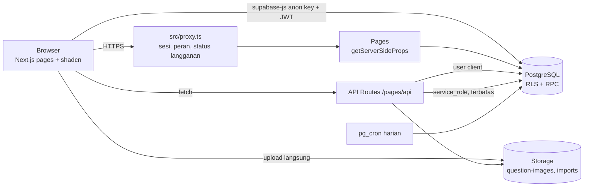

# Architecture — Website Ujian Sekolah

Rencana implementasi lengkap, dipecah menjadi tugas kecil dengan kriteria selesai.
Rujukan: `docs/PRD.md` (fitur), `AGENTS.md` (aturan coding), `supabase/schema.sql` (skema).

---

## 1. Tech stack

### 1.1 Inti

| Lapisan | Teknologi | Catatan |
| --- | --- | --- |
| Bahasa | TypeScript (strict) | |
| Framework | Next.js **Pages Router** | `getServerSideProps`, API Routes, `src/proxy.ts` (pengganti `middleware.ts` di Next 16) |
| UI | shadcn/ui + Tailwind CSS | Bahasa antarmuka: Indonesia |
| Database | Supabase PostgreSQL | RLS untuk isolasi tenant |
| Auth | Supabase Auth (email + password) | Murid memakai email sintetis `nis@kode.siswa.local` |
| Storage | Supabase Storage | Bucket privat `question-images`, `imports` |
| Server logic | Next.js API Routes + Postgres function (RPC) | Logika kritis (nilai, waktu, transaksi) di RPC |
| Penjadwal | `pg_cron` | Cek langganan harian |
| Hosting app | Vercel | |
| Hosting DB | Supabase Cloud | Region Singapura (`ap-southeast-1`) |

### 1.2 Library pendukung

| Kebutuhan | Library |
| --- | --- |
| Client Supabase | `@supabase/supabase-js`, `@supabase/ssr` |
| Validasi | `zod` |
| Form | `react-hook-form` + `@hookform/resolvers` (dipakai komponen Form shadcn) |
| Data fetching client | `@tanstack/react-query` (cache, retry auto-save) |
| Excel import/ekspor | `xlsx` (SheetJS) |
| ZIP gambar | `jszip` |
| Kompres gambar | `browser-image-compression` |
| Ekspor PDF rapor | `@react-pdf/renderer` |
| Tanggal | `date-fns` (zona `Asia/Jakarta`) |
| Ikon | `lucide-react` |

### 1.3 Tooling & testing

| Kebutuhan | Tool |
| --- | --- |
| DB lokal & migrasi | Supabase CLI + Docker |
| Tes RLS & RPC | pgTAP (`supabase test db`) |
| Tes unit TS | Vitest |
| Tes E2E (alur utama) | Playwright |
| Lint/format | ESLint + Prettier |
| Repo & CI | GitHub + GitHub Actions (typecheck, lint, build, tes DB) |

### 1.4 Batasan tier gratis (tahap awal)

| Batasan | Dampak pada desain |
| --- | --- |
| Request body Vercel ±4,5 MB | File Excel/ZIP **diunggah langsung dari browser ke Storage** (bucket `imports`), API Route hanya menerima path-nya |
| Durasi fungsi Vercel terbatas | Import dibatasi 500 soal/file; proses berat (ekspor rapor besar) dipecah per kelas |
| Supabase Free: DB 500 MB, Storage 1 GB, project dijeda setelah ±7 hari tanpa aktivitas | Gambar dikompres ≤ 2 MB; pagination wajib; pantau ukuran |
| Vercel Hobby hanya untuk non-komersial | **Pindah ke Vercel Pro (atau hosting lain) sebelum sekolah pertama membayar** |

---

## 2. Gambaran arsitektur

### 2.1 Kapan memakai apa

| Jenis operasi | Jalur |
| --- | --- |
| Baca/tulis CRUD sederhana (mapel, kelas, soal) | Client → Supabase langsung, dilindungi RLS |
| Operasi multi-langkah / transaksi (submit, remedial, ujian ulang, import, kenaikan kelas, pembayaran) | RPC `SECURITY DEFINER` |
| Butuh secret, Auth Admin API, atau parsing file (buat akun, import Excel, ekspor rapor) | API Route |
| Data halaman awal yang butuh proteksi peran | `getServerSideProps` |

### 2.2 Lapisan keamanan (berlapis)

1. `src/proxy.ts` — tolak tanpa sesi, arahkan ke `/subscription-expired` jika tenant nonaktif, cocokkan prefix URL dengan peran.
2. `getServerSideProps` / API Route — cek ulang peran dari `profiles`.
3. RLS — `my_tenant()`, `my_role()`, `tenant_is_active()` di setiap policy.
4. RPC — validasi peran, kepemilikan, dan waktu di dalam fungsi.

### 2.3 Alur kunci

- **Login murid:** form (kode sekolah, NIS, password) → client menyusun `nis@kode.siswa.local` → `signInWithPassword`.
- **Mengerjakan ujian:** `start_attempt(exam_id, token)` → mengembalikan `attempt_id`, `deadline_at`, `session_id` → `get_exam_questions(attempt_id)` (tanpa kunci) → `save_answer()` debounce 1 detik → `submit_attempt()` atau auto-submit saat `deadline_at`.
- **Satu sesi aktif:** setiap `start_attempt` dari perangkat baru memutar `session_id`; `save_answer` dengan `session_id` lama ditolak.
- **Langganan:** `mark_payment_paid()` → `active_until` bertambah 1 bulan → `pg_cron` harian kirim pengingat H-7/3/1 dan menonaktifkan tenant yang lewat masa aktif (kecuali attempt yang sedang berjalan sampai `end_at` ujian).

---

## 3. Konvensi rencana

- ID tugas: `F<fase>.<nomor>` (misal `F1.3`). Kerjakan berurutan kecuali disebut lain.
- Satu tugas ≈ satu branch / satu PR, idealnya ½–1 hari kerja.
- **Definition of Done umum** (berlaku untuk semua tugas, selain kriteria khusus):
  - `npm run typecheck`, `npm run lint`, `npm run build` lolos.
  - Perubahan skema berupa migrasi baru; `supabase db reset` sukses; `types/database.ts` diperbarui.
  - Tabel baru punya RLS + tes pgTAP isolasi tenant.
  - UI berbahasa Indonesia dan tampil benar di lebar HP (360 px).
  - Ada catatan cara uji manual di deskripsi PR.

---

## 4. Rencana implementasi

### Fase 0 — Persiapan proyek

**F0.1 Inisialisasi repo Next.js**
- Next.js Pages Router + TypeScript strict + Tailwind + ESLint/Prettier, folder `src/`.
- Selesai bila: `npm run dev` menampilkan halaman awal; tidak ada folder `app/`; script `typecheck` tersedia.

**F0.2 Setup shadcn/ui & layout dasar**
- `npx shadcn init`; tambah button, input, form, card, table, dialog, toast, dropdown-menu, badge, tabs.
- Selesai bila: halaman contoh merender komponen; tema terang berfungsi.

**F0.3 Setup Supabase lokal & cloud**
- `supabase init`, project cloud (region Singapura), `.env.local` (URL, anon key, service_role).
- Selesai bila: `supabase start` jalan; `.env.example` tercatat tanpa nilai rahasia; `.env*` di `.gitignore`.

**F0.4 Client Supabase**
- `lib/supabase/browser.ts`, `server.ts` (untuk API Route/`getServerSideProps`/`src/proxy.ts`), `admin.ts` (service_role, server only).
- Selesai bila: halaman uji membaca `auth.getUser()` di client dan di `getServerSideProps`; `admin.ts` tidak bisa di-import dari kode client (dicek dengan `import 'server-only'` atau lint rule).

**F0.5 CI**
- GitHub Actions: install, typecheck, lint, build, `supabase test db`.
- Selesai bila: PR menampilkan status hijau/merah otomatis.

**F0.6 Deploy awal**
- Hubungkan repo ke Vercel, set env var.
- Selesai bila: URL preview dapat diakses dan terhubung ke Supabase cloud.

---

### Fase 1 — Fondasi multi-tenant

**F1.1 Migrasi: enum, `tenants`, `subscriptions`, `profiles`**
- Enum `user_role`, `tenant_status`, `payment_status`; kolom sesuai ERD; `nis_nip` unik per tenant.
- Selesai bila: `db reset` sukses; constraint unik `(tenant_id, nis_nip)` teruji.

**F1.2 Fungsi helper RLS**
- `my_tenant()`, `my_role()`, `is_super_admin()`, `tenant_is_active()` (`STABLE`, `SECURITY DEFINER`, `search_path` diset).
- Selesai bila: tes pgTAP memverifikasi nilai yang benar untuk tiap peran seed dan untuk tenant nonaktif.

**F1.3 Policy RLS tabel fondasi**
- `tenants`, `subscriptions`, `profiles` sesuai matriks akses.
- Selesai bila: tes pgTAP — user sekolah A tidak bisa membaca profil sekolah B; user tenant nonaktif mendapat 0 baris; Super Admin melihat semua.

**F1.4 Seed fondasi**
- 2 sekolah (1 aktif, 1 habis), 1 Super Admin, 2 Admin Sekolah, guru & murid seed; password `Password123!`.
- Selesai bila: semua akun seed bisa login di lokal.

**F1.5 Login staf & login murid**
- `/login` dengan dua tab: Staf (email) dan Murid (kode sekolah + NIS).
- Selesai bila: login sukses mengarahkan ke dashboard sesuai peran; pesan error generik ("Kode sekolah, NIS, atau password salah"); logout berfungsi.

**F1.6 Middleware sesi, peran, langganan**
- Pemetaan prefix: `/admin` → super_admin, `/school` → school_admin, `/teacher` → teacher, `/student` → student.
- Selesai bila: akses tanpa login → `/login`; peran salah → 403; tenant nonaktif → `/subscription-expired`; akun `is_active=false` ditolak.

**F1.7 Layout & dashboard kosong per peran**
- Sidebar/navbar per peran, nama sekolah, menu sesuai matriks akses.
- Selesai bila: tiap akun seed melihat menu yang benar saja.

**F1.8 Super Admin: kelola sekolah**
- Daftar, tambah (kode unik huruf besar), ubah, lihat detail; buat Admin Sekolah pertama via API Route (Auth Admin API).
- Selesai bila: sekolah baru + adminnya bisa login; kode duplikat ditolak; tercatat di `audit_logs`.

**F1.9 Super Admin: langganan & pembayaran**
- RPC `mark_payment_paid(subscription_id)`: perpanjang dari `active_until` lama atau dari hari ini bila sudah lewat; aktifkan tenant. Nonaktifkan manual.
- Selesai bila: tes pgTAP untuk kedua kasus tanggal; sekolah nonaktif langsung bisa dipakai lagi setelah lunas; tercatat di `audit_logs`.

**F1.10 Job `pg_cron` harian**
- `run_subscription_check()`: notifikasi H-7/3/1 ke Admin Sekolah (tanpa duplikat di hari yang sama), nonaktifkan tenant yang lewat `active_until`.
- Selesai bila: tes pgTAP dengan tanggal simulasi; job terdaftar di `cron.job` (jam 00:05 WIB).

**F1.11 Halaman "Langganan berakhir" & status untuk Admin Sekolah**
- Selesai bila: halaman menampilkan nama sekolah dan kontak perpanjangan; Admin Sekolah aktif melihat sisa masa aktif di dashboard.

**F1.12 Dashboard Super Admin**
- Jumlah sekolah aktif/nonaktif, pendapatan per bulan, sekolah yang habis ≤ 7 hari, jumlah ujian.
- Selesai bila: angka cocok dengan data seed.

---

### Fase 2 — Struktur sekolah & bank soal

**F2.1 Migrasi struktur sekolah**
- `academic_years`, `subjects`, `classes`, `class_students`, `teaching_assignments` + RLS + index.
- Selesai bila: hanya satu tahun ajaran aktif per tenant (partial unique index); satu murid satu kelas per tahun ajaran; tes isolasi tenant lolos.

**F2.2 Admin Sekolah: tahun ajaran & mapel**
- CRUD + tombol "Jadikan aktif".
- Selesai bila: mengaktifkan satu tahun ajaran otomatis menonaktifkan yang lain; kode mapel unik per sekolah.

**F2.3 Admin Sekolah: akun guru & murid (manual)**
- Tambah, ubah, reset password, nonaktifkan (API Route + Auth Admin API).
- Selesai bila: murid baru langsung bisa login dengan kode sekolah + NIS; akun nonaktif tidak bisa login; NIS duplikat ditolak.

**F2.4 Import murid dari Excel**
- Template (NIS, nama, kelas, password awal) → preview + error per baris → simpan.
- Selesai bila: file dengan error tidak menyimpan apa pun; file valid 300 baris berhasil; murid otomatis masuk kelasnya.

**F2.5 Admin Sekolah: kelas & wali kelas**
- CRUD kelas per tahun ajaran, tetapkan wali kelas, tambah/keluarkan murid.
- Selesai bila: wali kelas hanya bisa dipilih dari guru sekolah itu; daftar murid per kelas tampil.

**F2.6 Admin Sekolah: penugasan guru**
- Matriks guru × mapel × kelas.
- Selesai bila: guru melihat daftar kelas & mapel yang diampunya di dashboard.

**F2.7 Migrasi bank soal**
- Enum `question_type`; `questions` (+ `parent_id`), `question_options`, `question_pairs`, `import_jobs` + RLS.
- Selesai bila: guru hanya mengelola soal miliknya; guru/Admin Sekolah lain di sekolah sama hanya baca; **murid tidak punya akses SELECT sama sekali** (tes pgTAP).

**F2.8 Storage gambar soal**
- Bucket privat `question-images`, path `{tenant_id}/{question_id}/...`, policy per tenant, signed URL.
- Selesai bila: upload dari sekolah A ke folder sekolah B ditolak; file > 2 MB atau bukan JPG/PNG/WebP ditolak.

**F2.9 Editor soal: PG & Benar/Salah**
- Form dengan 2–5 opsi, satu kunci, gambar di soal & opsi (kompres di browser), poin, pembahasan.
- Selesai bila: soal tersimpan dan tampil benar di daftar; validasi tepat satu kunci.

**F2.10 Editor soal: Isian & Menjodohkan**
- Isian: beberapa jawaban diterima. Menjodohkan: pasangan kiri–kanan, `right_key` acak.
- Selesai bila: data pasangan tersimpan tanpa urutan yang membocorkan kunci.

**F2.11 Editor soal: Essay & Multi Essay**
- Jawaban acuan, kata kunci, poin; multi essay dengan sub-soal (`parent_id`).
- Selesai bila: total poin multi essay = jumlah poin sub-soal; sub-soal bisa ditambah/hapus/urut.

**F2.12 Daftar bank soal**
- Filter mapel/tipe, cari teks, pagination, duplikat soal, preview tampilan murid.
- Selesai bila: 500 soal tetap responsif (pagination server).

**F2.13 Template & parser import soal Excel**
- Unduh template; parser + validator di API Route (semua kolom PRD); unit test Vitest per tipe soal.
- Selesai bila: unit test mencakup baris valid dan error (kunci kosong, opsi kurang, `induk` tidak ada, `kode_mapel` tak dikenal).

**F2.14 Import soal: upload, preview, simpan**
- Browser unggah `.xlsx` (+ `.zip` gambar) ke bucket `imports` → API Route parse → preview + error per baris → RPC `import_questions(job_id, payload)` satu transaksi.
- Selesai bila: satu error = tidak ada soal tersimpan; gambar dari ZIP terpasang di soal/opsi; riwayat di `import_jobs`; maks 500 soal ditegakkan.

---

### Fase 3 — Ujian & penilaian

**F3.1 Migrasi ujian**
- `exams`, `exam_classes`, `exam_participants`, `exam_questions`, `exam_attempts` (+ `deadline_at`, `session_id`, `tab_switch_count`), `attempt_answers` + RLS.
- Selesai bila: RLS `exam_classes` hanya mengizinkan kelas yang diampu guru untuk mapel ujian (tes pgTAP).

**F3.2 Trigger peserta**
- Isi `exam_participants` dari `exam_classes`; murid baru di kelas ikut ujian yang belum selesai.
- Selesai bila: tes pgTAP menambah kelas, menambah murid ke kelas, dan menambah murid perorangan.

**F3.3 Wizard buat ujian (guru)**
- Langkah: info (judul, mapel, jadwal, durasi, KKM) → kelas + murid tambahan → pilih soal dari bank (urutan, poin override) → pengaturan (acak soal/opsi, fullscreen, batas pindah tab, ambang essay, mode tampil nilai) → simpan draft / terbitkan.
- Selesai bila: ujian tanpa soal tidak bisa diterbitkan; total poin tampil; ujian terbit mengirim notifikasi ke peserta.

**F3.4 Token ujian**
- Token 6 karakter (tanpa karakter ambigu 0/O/1/I), tombol perbarui.
- Selesai bila: token lama ditolak setelah diperbarui; token berbeda per ujian.

**F3.5 Preview ujian (guru)**
- Selesai bila: guru bisa mencoba ujian tanpa membuat attempt yang tercatat.

**F3.6 Daftar ujian murid**
- Tab: akan datang, berlangsung, selesai.
- Selesai bila: murid hanya melihat ujian di mana ia peserta.

**F3.7 RPC `start_attempt` & `get_exam_questions`**
- Validasi peserta, jadwal, token, attempt belum ada (atau dilanjutkan); hitung `deadline_at = min(start + durasi, end_at)`; acak urutan per attempt (disimpan agar konsisten saat refresh).
- Selesai bila: respons tidak memuat `is_correct`, `answer_key`, `accepted_answers`, `keywords`, atau pasangan benar (tes pgTAP + tes API); refresh mengembalikan urutan yang sama.

**F3.8 Halaman ujian: tampilan & navigasi**
- Render 6 tipe soal, panel nomor, tanda ragu-ragu, timer dari `deadline_at` server.
- Selesai bila: semua tipe bisa dijawab; status nomor (terjawab/ragu/kosong) akurat; layout baik di HP.

**F3.9 Auto-save & lanjutkan sesi**
- RPC `save_answer(attempt_id, session_id, question_id, jawaban)` debounce 1 detik; antrean offline + kirim ulang.
- Selesai bila: matikan jaringan → jawab → nyalakan → tersimpan; ganti perangkat melanjutkan jawaban; perangkat lama ditolak (sesi diputar); simpan setelah `deadline_at` ditolak.

**F3.10 Fullscreen & pindah tab**
- Peringatan keluar fullscreen/pindah tab; hitung di server; auto-submit bila melebihi batas (jika diaktifkan).
- Selesai bila: hitungan tersimpan di attempt; auto-submit terjadi tepat saat batas terlampaui.

**F3.11 RPC `submit_attempt` — penilaian otomatis**
- PG/BS: cocok opsi. Isian: normalisasi (huruf kecil, trim, spasi tunggal) lalu cocok dengan salah satu jawaban diterima. Menjodohkan: poin × (pasangan benar / total). Essay: `similarity()` `pg_trgm` setelah normalisasi; poin = maks × skor; di bawah ambang → `needs_review`. Multi essay: per sub-soal.
- Selesai bila: tes pgTAP per tipe soal dengan kasus benar, salah, sebagian; auto-submit saat waktu habis memakai jawaban tersimpan.

**F3.12 Monitoring ujian (guru)**
- Status tiap peserta (belum mulai/mengerjakan/selesai), jumlah pindah tab; polling tiap 10 detik.
- Selesai bila: status berubah tanpa reload dalam ≤ 10 detik.

**F3.13 Antrean koreksi essay**
- Daftar jawaban `needs_review`; tampil jawaban, acuan, skor kemiripan; isi `manual_points` + catatan → `recalc_attempt()`.
- Selesai bila: nilai akhir berubah sesuai koreksi; perubahan tercatat di `audit_logs`.

**F3.14 Publikasi nilai & halaman nilai murid**
- Publikasi per ujian; murid melihat nilai + pembahasan sesuai mode tampil nilai.
- Selesai bila: sebelum publikasi murid tidak melihat nilai (dicek di RLS, bukan hanya UI); notifikasi terkirim.

**F3.15 Uji beban halaman ujian**
- Skrip simulasi 40 murid serentak (start, save, submit).
- Selesai bila: halaman ujian < 2 detik dan tidak ada jawaban hilang.

---

### Fase 4 — Remedial, ujian ulang, report, notifikasi

**F4.1 RPC `open_remedial`**
- Buat ujian `exam_type = remedial`, `parent_exam_id`, peserta = murid di bawah KKM (attempt valid terakhir).
- Selesai bila: nilai ujian induk tidak berubah; hanya guru pemilik / Admin Sekolah yang bisa; notifikasi ke peserta remedial.

**F4.2 Pengajuan ujian ulang**
- Migrasi `retake_requests`; guru mengajukan per murid dengan alasan.
- Selesai bila: tidak bisa mengajukan dua kali untuk murid & ujian yang sama selagi `pending`; Admin Sekolah menerima notifikasi.

**F4.3 RPC `decide_retake`**
- Admin Sekolah setuju/tolak dengan alasan; setuju → attempt lama `is_voided = true`, murid bisa mulai attempt baru (perpanjang jadwal individual bila ujian sudah lewat).
- Selesai bila: attempt lama tetap ada; guru menerima notifikasi keputusan; tercatat di `audit_logs`.

**F4.4 Notifikasi dalam aplikasi**
- Ikon lonceng + jumlah belum dibaca, daftar, tandai dibaca.
- Selesai bila: kelima kejadian di PRD menghasilkan notifikasi ke penerima yang benar.

**F4.5 Report per ujian (guru)**
- Rekap nilai, rata-rata, tertinggi/terendah, jumlah di bawah KKM; ekspor Excel.
- Selesai bila: angka cocok dengan data attempt (attempt `is_voided` tidak dihitung).

**F4.6 Analisis butir soal**
- Tingkat kesukaran (proporsi benar) dan sebaran jawaban per opsi.
- Selesai bila: tampil untuk PG/BS; dihitung dari attempt valid saja.

**F4.7 Report sekolah (Admin Sekolah)**
- Rekap per ujian dan per kelas, filter tahun ajaran.
- Selesai bila: Admin Sekolah hanya melihat data sekolahnya.

**F4.8 Kenaikan kelas**
- RPC `promote_class(from_class_id, to_class_id, student_ids)`.
- Selesai bila: murid masuk kelas baru di tahun ajaran berikutnya; report tahun lama tetap per kelas lama.

**F4.9 Ekspor rapor (Excel & PDF)**
- **Prasyarat:** contoh format rapor dari sekolah pertama.
- Selesai bila: rapor per kelas bisa diunduh; format disetujui sekolah.

**F4.10 Audit log viewer**
- Super Admin (semua) dan Admin Sekolah (sekolahnya), filter aksi & tanggal.
- Selesai bila: perubahan nilai, ujian ulang, dan langganan tampil dengan nilai lama/baru.

**F4.11 Hardening sebelum rilis**
- Tes E2E Playwright alur utama (login murid → ujian → nilai); tinjau semua policy RLS; cek tidak ada `service_role` di bundle client; pindah Vercel ke paket komersial.
- Selesai bila: tes E2E hijau di CI; checklist keamanan di bagian 5 terpenuhi.

---

### Fase 5 — Pengembangan lanjutan

**F5.1 Payment gateway (Midtrans/Xendit)**
- Webhook → `mark_payment_paid()` otomatis.
- Selesai bila: pembayaran sandbox memperpanjang masa aktif tanpa input manual; webhook diverifikasi signature.

**F5.2 Penilaian essay semantik**
- Embedding (pgvector) atau LLM sebagai pengganti `similarity()`, dengan fallback.
- Selesai bila: dibandingkan dengan sampel koreksi guru, akurasi lebih baik dari `pg_trgm`.

**F5.3 Paket langganan & masa trial**
- Paket berdasarkan jumlah murid; trial 7–14 hari.
- Selesai bila: batas murid per paket ditegakkan; trial berakhir otomatis lewat job harian.

---

## 5. Checklist keamanan (wajib sebelum rilis)

- [ ] Semua tabel data sekolah: RLS aktif + tes isolasi tenant.
- [ ] Murid tidak bisa SELECT tabel soal/opsi/pasangan.
- [ ] Nilai dan waktu hanya dihitung di RPC.
- [ ] `service_role` hanya di server; tidak ada di bundle client.
- [ ] Bucket Storage privat; akses via signed URL.
- [ ] Tenant nonaktif: 0 akses (kecuali masa tenggang ujian berjalan).
- [ ] Perubahan nilai, ujian ulang, langganan tercatat di `audit_logs`.

## 6. Ketergantungan & keputusan terbuka

| Item | Menghambat | Status |
| --- | --- | --- |
| Harga langganan & diskon 6/12 bulan | F1.9 (nominal), F5.3 | Terbuka |
| Admin Sekolah boleh membuat soal/ujian? | F2.7 (RLS), F3.3 | Terbuka |
| Contoh format rapor | F4.9 | Menunggu sekolah pertama |
| Hosting komersial (Vercel Pro / alternatif) | Rilis berbayar | Terbuka |
